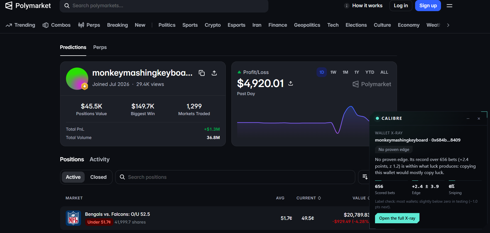

# CALIBRE: Whale X-ray for prediction markets

Before you chase a price move or copy a whale, see whether the money behind it comes from traders who reliably lose.

**Live:** https://calibre-blush.vercel.app · Built for **Total Recall: Tatum x Walrus Memory** (Track 01, Markets & Sports Prediction)

On Polymarket a market jumps 8 points and everyone asks who knows something. Usually nobody does. CALIBRE looks at the wallets
that pushed the price, scores each one against the prices it actually paid on its past bets, and tells you in plain words
whether the move came from proven losers, from the rare proven winner, or from wallets with no record either way. Every judgement
on a live move is sealed on Walrus Memory before the result is known, and graded in public afterwards.



*The Chrome extension on a live Polymarket profile: up $1.3M, yet over 656 bets its edge is within what luck produces.*

## By the numbers

| | |
|---|---|
| **$1.78 billion** | traded in the 4,587 closed sports markets the square-money replay covers (Polymarket's own volume figure, 142 leagues) |
| **$197.6 million** | of money behind 11,975 replayed price moves, traced to 10,113 wallets |
| **790,185 bets** | scored against the price paid, across 5,740 wallets and 69,914 wallet-by-league records |
| **356,116 bets** | in the profit-blind study of 1,000 wallets behind the label test |
| **59 verdicts** | sealed on Walrus Memory mainnet before the result was known; 48 graded, 378 memories in all |
| **59 of 59 verdicts** | stamped with a Sui checkpoint read through Tatum's Sui gRPC gateway |
| **643 Tatum API calls** | by the mainnet watcher to find and track live markets, inside a budget built to last the free plan |
| **1 paid agent call** | settled on Sui mainnet: 0.01 USDC, gas price 0 |

Every figure is a plain sum over the study outputs (`scripts/scale-stats.ts`), not an estimate.

## What it does

| | |
|---|---|
| **Wallet X-ray** (`/wallet/<address>`) | Edge per bet against the price paid, with an error band; pre-game and in-play split; share of "sniping" bets at already-decided prices; a label: *proven losing record*, *proven winning record*, *mostly sniping*, *too early*, *no proven edge*. |
| **Market X-ray** (`/market/<slug>`) | The latest move of 4+ points, its biggest takers, and how much of the pushing money came from proven losers (with how much of it could be judged). A price settling at 0 or 1 is not treated as a move. |
| **Radar** (`/radar`) | Moves the watcher judged and sealed, newest first. |
| **Record** (`/record`) | Every sealed verdict with its grade once the market resolved. |
| **Chrome extension** (`apps/extension`) | The same X-ray as a panel on polymarket.com profile, event, sports and esports pages. |
| **Paid agent API** (`/api/v1/xray/<address>`) | The wallet X-ray for agents at 0.01 USDC per call over MPP on Sui. Gasless for the buyer. |
| **MCP server** (`apps/mcp`) | `wallet_audit` and `latest_verdicts` for Claude Code or any MCP client. No keys needed. |

Every X-ray runs live on the server, and Tatum is in each one:

- **Stamped through Tatum's Sui gRPC.** Each wallet and market X-ray says which Sui checkpoint it was read at (one gRPC query,
  2 credits, shared by all X-rays in a 15-second window).
- **Market X-rays read their fills from Tatum's Prediction Markets API** (100 credits a page, cached per market), with
  Polymarket's public Data API as the labelled fallback.
- **Wallet X-rays add Tatum's live view of the wallet:** open-position value and lifetime markets traded (50 credits each).
  The scored record itself comes from the wallet's full trade history on Polymarket's free Data API.
- **Paid agent calls are confirmed through Tatum's Sui gRPC:** the receipt carries the checkpoint that finalised the payment.

The server counts every Tatum request at its listed credit price against a daily budget and pauses Tatum after a plan error,
so the site never stops: when Tatum cannot answer, the free source takes over and the page says which one answered.
The radar, record and proof pages read files exported from Walrus Memory.

## Does the label mean anything? The evidence

All numbers come from scripts in this repository and are written up in [`docs/FINDINGS.md`](docs/FINDINGS.md).

**1. The labels predict what a wallet does next.** 1,000 wallets sampled without looking at profit. Each wallet gets the label it
would have had from its older half of bets; the table shows its newer half.

| Label from older bets | Wallets | Next-half edge, pts per bet [95% CI] | Negative next half |
|---|---:|---|---:|
| proven losing record | 57 | **-3.8** [-5.1, -2.4] | 81% |
| proven winning record (rare, strict) | 40 | **+2.2** [+0.5, +4.1] | 38% |
| no proven edge | 801 | -1.0 [-1.3, -0.7] | 60% |

A proven losing record is the strongest signal CALIBRE has. Proven winners exist but are rare and modest. The profit leaderboard
carries no persistent signal at all (rank correlation -0.04, p 0.57).

**2. Following loser-driven moves paid worse: early evidence, not conclusive.** A replay of 11,975 real moves of 6+ points in
4,587 closed sports markets, labelling each move's takers only with bets that had resolved before the move:

| Moves pushed by | Moves | Follow edge, pts [95% CI] |
|---|---:|---|
| proven losers (50%+ of labeled flow) | 436 | -2.4 [-6.4, +1.4] |
| no proven losers | 3,597 | +0.7 [-0.7, +2.1] |

Difference -3.1 pts, one-sided permutation p = 0.073, mostly in-play. That is why square money is shown as a caution and CALIBRE
never tells anyone to trade against it.

**3. The sealed forecasts so far are level with the market.** 48 verdicts are graded on mainnet. Under the current models (v2
and v3, 46 verdicts) CALIBRE's forecast and the market price score within 0.001 Brier of each other; the 2 graded verdicts of
the first model are too few to count. The forecast is deliberately conservative (it moves the price at most 10 points): the
product is the X-ray, not a price prediction, and the record is public so this can be checked.

## How Walrus Memory is used

Walrus Memory (`@mysten-incubation/memwal`, Sui mainnet) is the system of record, not a cache:

- **`calibre-verdicts`**: when the watcher sees a move, it seals a verdict (label, forecast, price, takers with their labels,
  square-money share, the Sui checkpoint at that moment) *before* the market resolves. Failed or timed-out writes are retried
  with their original checkpoint and dropped if the market resolves first, so nothing is sealed with hindsight.
- **`calibre-outcomes`**: when the market resolves, the grader seals an outcome memory pointing at the verdict, with its Brier
  score against the market price.
- **`calibre-wallets`**: wallet-by-league track records. Memory is append-only, so a new record is a new version
  (`[cal1|kind|key|vN] summary || {json}`) and readers keep the latest version per key.

The proof page and the radar are rebuilt from Walrus alone: `pnpm verify` lists each namespace, recalls and decodes every verdict
and outcome, checks that each outcome has its verdict, and writes [`docs/PROOF.md`](docs/PROOF.md). Every row links to its blob
on Walruscan. Current counts: 59 verdicts, 48 outcomes, 271 wallet records.

## How Tatum is used

- **Sui gRPC gateway** (`sui-mainnet-grpc.gateway.tatum.io`), over native gRPC with `@grpc/grpc-js`: the Sui checkpoint
  that proves when each verdict was sealed. **All 59 sealed verdicts were stamped through it.** This is what makes a verdict a
  receipt: the checkpoint shows it existed before the market resolved (`packages/chain/src/suiGrpc.ts`).
- **Prediction Markets API** (`/v4/data/prediction`): the watcher's market discovery (sports and politics events by volume
  and liquidity), price history, trades and the resolution check before grading. 643 calls on mainnet
  (`packages/chain/src/prediction.ts`: budgeted per hour, cached, retried, with a circuit breaker).

The free plan is finite, so CALIBRE spends Tatum calls where they matter most and labels every fallback. The watcher capped
itself at 18 Tatum calls an hour and took trade fills from Polymarket's public Data API once the hour's allowance was used
(each verdict records which source it used). Grading asks Polymarket's free Gamma API which markets have resolved before
spending a Tatum call. The latest export, made after the free credits were used up, read its checkpoint from Sui's public
GraphQL and says so; the sealed verdicts themselves all carry Tatum checkpoints.

## Agent payments

`GET /api/v1/xray/<address>` answers 402 with an MPP challenge; the agent pays 0.01 USDC on Sui, the server checks the
transaction on chain and returns the X-ray with the digest as its receipt. Each digest pays for one call.

First real call, 4 Nov 2026: [`9edpkVC9QQegXDDwvxEt5dZyd2NZ36vBLw2yaqknF86K`](https://suiscan.xyz/mainnet/tx/9edpkVC9QQegXDDwvxEt5dZyd2NZ36vBLw2yaqknF86K),
checkpoint 341674249, 0.01 USDC from the agent to the API's wallet, gas price 0. Details: [`docs/AGENT_PAYMENTS.md`](docs/AGENT_PAYMENTS.md).

## Layout

| Path | What |
|---|---|
| `packages/core` | Edge metric, shrinkage, labels, square-money share, verdicts, grading, memory envelopes. Pure and tested. |
| `packages/public-data` | Wallet and market X-rays from Polymarket's public Data API and Gamma. |
| `packages/chain` | Tatum Prediction Markets client, Sui checkpoint (Tatum gRPC with public fallback). |
| `packages/memory` | Walrus Memory store, namespaces, encode and decode. |
| `apps/worker` | `watch` (judge and seal moves), `grade` (seal outcomes), `index` (wallet records). |
| `apps/web` | Next.js site and the free and paid APIs. |
| `apps/extension` | Chrome MV3 panel for polymarket.com. |
| `apps/mcp` | MCP server over stdio. |
| `scripts` | The studies (`skill-persistence.ts`, `validate-labels.ts`, `square-replay.ts`), `verify.ts`, `export-site.ts`, `agent-pay-demo.ts`. |

## Run it

```bash
pnpm install
pnpm test                         # 278 tests
pnpm --filter @calibre/web dev    # the site on http://localhost:3000, no keys needed
```

With keys in `.env` (copy `.env.example`: a free Tatum key, a Walrus Memory delegate key and account ID):

```bash
pnpm verify          # rebuild the proof from Walrus Memory
pnpm watch           # judge and seal live moves
pnpm grade           # grade resolved verdicts
pnpm export:site     # refresh apps/web/data from Walrus
```

Extension: download the zip from https://calibre-blush.vercel.app/extension and load it unpacked, or build it with
`pnpm --filter @calibre/extension build` and load `apps/extension/dist`. MCP:
`claude mcp add calibre -- pnpm --silent exec tsx apps/mcp/src/index.ts`.

## Limits

- Edge is measured against the price paid and ignores fees and bet size. Wallets trade the same events, so intervals are optimistic.
- The wallet X-ray reads a wallet's newest 1,000 trades; a long history is judged on its recent part.
- The square-money result is p = 0.073. It is early evidence, and the product says so wherever it appears.
- 271 wallet records are sealed on Walrus; the watcher labels takers from a larger local index (5,740 wallets) that is not all sealed.
